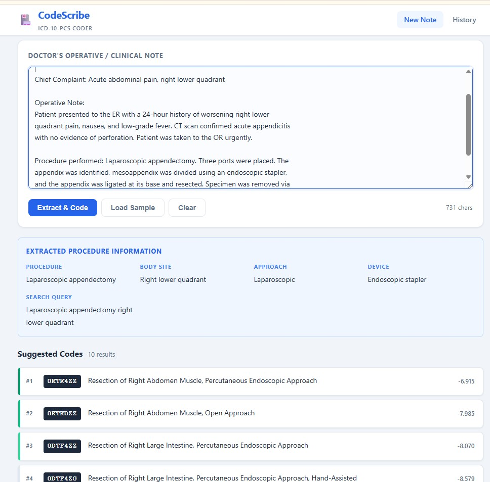

# CodeScribe

An AI-assisted ICD-10-PCS procedure coding tool. Paste a doctor's clinical note and get ranked ICD-10-PCS code suggestions in seconds — no cloud API required.

> [!NOTE]
> This project is built on **publicly available data from the Centers for Medicare & Medicaid Services (CMS)**.
> The ICD-10-PCS code set is published annually by CMS and is free to use with no licensing restrictions.
> Source files can be downloaded from the [CMS ICD-10 code files page](https://www.cms.gov/medicare/coding-billing/icd-10-codes).

---

## What it does

Medical coders spend significant time manually looking up the correct ICD-10-PCS procedure code from roughly 78,000 possibilities. CodeScribe automates the first pass:

1. A local LLM (Llama 3.1 via Ollama) reads the clinical note and extracts structured procedure details (procedure name, body site, approach, device, qualifier).
2. A semantic vector search over all 78k ICD-10-PCS 2027 codes finds the closest matches.
3. A cross-encoder reranker re-scores the candidates to surface the most relevant codes at the top.
4. The top suggestions are displayed to the coder for final review and selection.

All processing runs locally — no PHI leaves the machine.

---

## Screenshots



---

## Architecture

```
┌─────────────────────────────────────────────────────────────┐
│                        Browser (React)                       │
│   / — Note input + suggestions    /history — Past sessions   │
└───────────────────┬─────────────────────────────────────────┘
                    │ POST /api/notes
                    ▼
┌─────────────────────────────────────────────────────────────┐
│                   FastAPI  (backend/)                        │
│                                                              │
│  1. EXTRACTION                                               │
│     ollama_service.py                                        │
│     → HTTP to Ollama (llama3.1:8b, temp=0.1)                │
│     → returns JSON: procedure_name, body_site, approach,     │
│       device, qualifier, query                               │
│                                                              │
│  2. VECTOR SEARCH + RERANK                                   │
│     chroma_service.py                                        │
│     → ChromaDB cosine search (all-MiniLM-L6-v2 embeddings)  │
│       fetches RERANK_CANDIDATES (default 20)                 │
│     → cross-encoder/ms-marco-MiniLM-L-6-v2 reranks them     │
│     → returns top TOP_K_RESULTS (default 10)                 │
│                                                              │
│  3. PERSISTENCE                                              │
│     SQLite via SQLAlchemy (sync)                             │
│     Note ──► CodingSession ──► SuggestedCode[]              │
└──────────────┬──────────────────────────┬───────────────────┘
               │                          │
               ▼                          ▼
        Ollama (local)              ChromaDB (local)
        llama3.1:8b                 ~78k ICD-10-PCS 2027
        :11434                      all-MiniLM-L6-v2 embeddings
```

### Data flow summary

```
Clinical note
     │
     ├─► Ollama LLM ──► extracted fields + search query
     │
     ├─► ChromaDB (cosine) ──► 20 candidates
     │        │
     │        └─► Cross-encoder rerank ──► top 10 suggestions
     │
     └─► SQLite: Note → CodingSession → SuggestedCode[]
```

---

## Tech stack

| Layer | Technology |
|---|---|
| Frontend | React 18, Vite, Axios |
| Backend | FastAPI, Python 3.14, SQLAlchemy (sync), Alembic |
| LLM | Ollama — `llama3.1:8b` (local, no API key needed) |
| Vector DB | ChromaDB (persistent, local) |
| Embeddings | `all-MiniLM-L6-v2` via sentence-transformers |
| Reranker | `cross-encoder/ms-marco-MiniLM-L-6-v2` |
| Database | SQLite |
| Source data | ICD-10-PCS 2027 (~78,000 codes) |

---

## How to run

### Prerequisites

- Python 3.11+
- Node.js 18+
- [Ollama](https://ollama.com) installed and running

### 1 — Start Ollama and pull the model

```bash
ollama serve
ollama pull llama3.1:8b
```

### 2 — Backend setup

> **Note:** `icd10pcs_codes_2027.txt` is downloaded automatically from CMS the first time `seed_chroma.py` runs. No manual download needed. The URL is configurable via `CMS_SOURCE_URL` in `backend/.env`.

```powershell
cd backend

# Windows
powershell -ExecutionPolicy Bypass
.venv\Scripts\Activate.ps1       # or: python -m venv .venv first

pip install -r requirements.txt

# Create the database schema
alembic upgrade head

# Seed ChromaDB — downloads source file from CMS, embeds all ~78k codes (runs once, ~30–60 min on CPU)
python scripts/seed_chroma.py

# Start the API server
uvicorn app.main:app --reload
# → http://localhost:8000
```

Health check: `GET http://localhost:8000/api/health` — `"ready": true` means seeding is complete.

### 3 — Frontend setup

```bash
cd frontend
npm install
npm run dev
# → http://localhost:5173
```

### Configuration (`backend/.env`)

| Variable | Default | Purpose |
|---|---|---|
| `OLLAMA_MODEL` | `llama3.1:8b` | Any model available in Ollama |
| `OLLAMA_TIMEOUT` | `120` | Seconds; increase for slow hardware |
| `RERANK_CANDIDATES` | `20` | Candidates fetched before reranking |
| `TOP_K_RESULTS` | `10` | Final results returned to the UI |
| `CHROMA_DB_PATH` | `./chroma_db` | Persistent ChromaDB directory |

---

## Extending this MVP

This project is intentionally minimal. Below are the most impactful directions for a production build.

### Accuracy improvements

| Enhancement | How |
|---|---|
| Larger / fine-tuned LLM | Swap `OLLAMA_MODEL` for a medically fine-tuned model (e.g. `meditron`, `med42`) or route through OpenAI/Anthropic for higher extraction quality |
| Fine-tune the reranker | Collect coder feedback (accepted / rejected suggestions) and use it as training signal to fine-tune the cross-encoder on ICD-10-PCS data |
| Hybrid search | Combine BM25 keyword search with the existing dense vector search (reciprocal rank fusion) to catch exact code-number lookups |
| ICD-10-CM support | Add a second ChromaDB collection for diagnosis codes and run the same pipeline in parallel |

### Workflow & UX

| Enhancement | How |
|---|---|
| Coder feedback loop | Add accept/reject buttons per suggestion; log to a `CodeFeedback` table; surface acceptance rate metrics |
| Code confirmation & export | Let coders lock in a final code per session and export to CSV / HL7 / FHIR |
| Multi-procedure notes | Detect and split notes that describe more than one procedure; run the pipeline for each segment |
| Batch processing | Accept a bulk upload of notes (CSV/HL7) and process them asynchronously via a task queue (Celery + Redis) |

### Infrastructure & compliance

| Enhancement | How |
|---|---|
| Authentication | Add JWT auth (FastAPI-Users) and role-based access (coder, reviewer, admin) |
| Audit trail | Log every suggestion shown and every code confirmed with user ID and timestamp for compliance |
| HIPAA / PHI controls | Deploy entirely on-prem or in a HIPAA-eligible cloud environment; add encryption at rest for the SQLite DB |
| Replace SQLite | Migrate to PostgreSQL for multi-user concurrency; the SQLAlchemy models require no changes |
| Containerise | Add `Dockerfile` + `docker-compose.yml` for backend, frontend, and Ollama together |
| Annual code update | Replace the source flat file and re-run `seed_chroma.py` each October when CMS publishes new ICD-10-PCS tables |

---

## Project structure

```
codescribe/
├── source files/          # ICD-10-PCS 2027 raw data (read-only)
├── backend/
│   ├── app/
│   │   ├── main.py
│   │   ├── config.py      # All settings via pydantic-settings + .env
│   │   ├── models.py      # SQLAlchemy ORM: Note, CodingSession, SuggestedCode
│   │   ├── schemas.py     # Pydantic request/response models
│   │   ├── database.py
│   │   ├── routes/
│   │   │   └── notes.py
│   │   └── services/
│   │       ├── ollama_service.py   # LLM extraction
│   │       ├── chroma_service.py   # Vector search + reranking
│   │       └── coding_service.py  # Orchestration + persistence
│   ├── scripts/
│   │   ├── parse_pcs.py   # Parses the flat ICD-10-PCS source file
│   │   └── seed_chroma.py # One-time ChromaDB seeding
│   ├── alembic/           # Database migrations
│   └── requirements.txt
└── frontend/
    ├── src/
    │   ├── api/client.js  # Axios, baseURL /api, 3-min timeout
    │   └── ...            # React components, two routes: / and /history
    └── package.json
```
